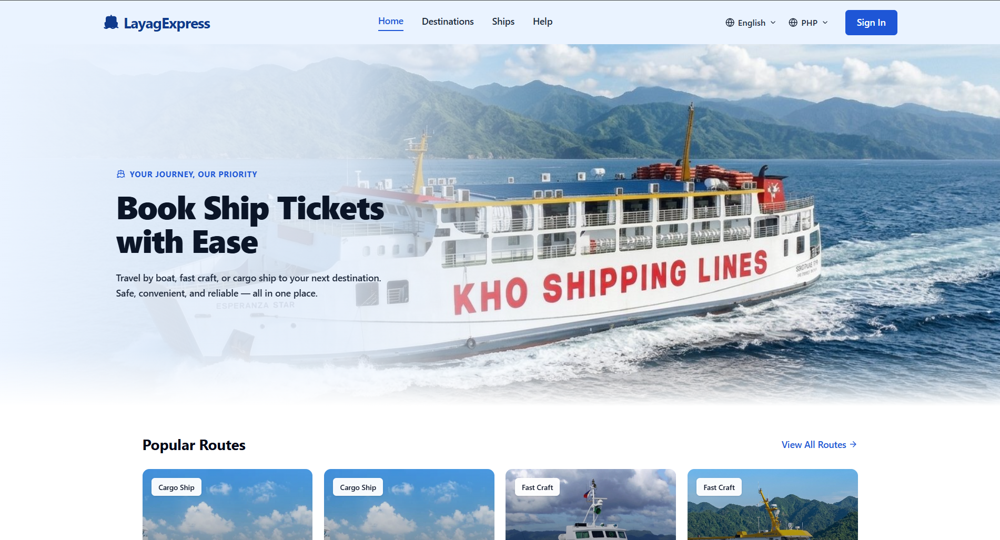

# LayagExpress

_Book your voyage, skip the queue._

[Overview](#overview) · [Features](#features) · [API](#api) https://layagexpress.vercel.app/

## Overview

LayagExpress is an online ship-ticketing system for a Philippine ferry operator. Passengers search sailings, choose their seats, pay online or at the counter, and keep their tickets and invoices in one place. Administrators manage the fleet, routes, schedules, bookings, refunds and passenger accounts from a single dashboard.

## Features

| Passengers                                          | Administrators                                                   |
| --------------------------------------------------- | ---------------------------------------------------------------- |
| Search sailings by route and date                   | Add, edit and remove vessels, routes and trips                   |
| Book passenger or cargo trips and pick seats        | Confirm counter payments and review bank-transfer proofs         |
| Pay online (simulated gateway) or at the counter    | Cancel a trip for bad weather so passengers reschedule or refund |
| Cancel or reschedule up to 4 hours before departure | Approve or decline refunds, with a reason the customer can read  |
| Track tickets, QR codes, invoices and notifications | Manage passenger accounts and reset passwords                    |
| Manage profile, saved wallets and language          | Monitor dashboard stats, fleet map and reports                   |

Every administrative action is authorised on the server: protected endpoints require a bearer token, and administrative endpoints are restricted to administrator accounts. Sign-in uses a password plus Google Authenticator (TOTP), with encrypted secrets and replay protection.

## Technology

| Frontend                                | Backend                       | Data              |
| --------------------------------------- | ----------------------------- | ----------------- |
| React, Vite, React Router, Tailwind CSS | Node.js, Express, JWT, bcrypt | MongoDB, Mongoose |

## API

| Area               | Endpoints                                                                                                                                                       |
| ------------------ | --------------------------------------------------------------------------------------------------------------------------------------------------------------- |
| Health             | `GET /`                                                                                                                                                         |
| Authentication     | `POST /api/auth/register`, `POST /api/auth/login`, `POST /api/auth/admin/login`, `POST /api/auth/verify-mfa`, `GET/PUT /api/auth/me`                            |
| Trips              | `GET /api/trips`, `GET /api/trips/:id`, `GET /api/trips/:id/seats`                                                                                              |
| Bookings           | `POST /api/bookings`, `GET /api/bookings/my`, `PATCH /api/bookings/:id/cancel`, `GET /api/bookings/:id/reschedule-options`, `POST /api/bookings/:id/reschedule` |
| Payments           | `GET /api/payments/my`, `POST /api/payments/:id/pay-online`, `POST /api/payments/:id/refund-request`                                                            |
| Invoices & Tickets | `GET /api/invoices/my`, `GET /api/tickets/my?when=upcoming`, `PATCH /api/tickets/:id/board`                                                                     |
| Notifications      | `GET /api/notifications/my`, `PATCH /api/notifications/read-all`                                                                                                |
| Administration     | Bookings, payments and refunds, users, vessels, routes and stats under `/api/{bookings,payments,users,boats,routes,trips,admin}`                                |

Protected endpoints require a valid bearer token. Administrative endpoints are restricted to administrator accounts.

### Refund flow

1. A passenger cancels a paid booking (or requests a refund) and the payment becomes `refund_pending`.
2. The administrator approves or declines it from **Admin → Bookings → Refund requests**, always with a reason.
3. The customer sees the decision, the amount and both reasons on the booking page and is notified in-app.
